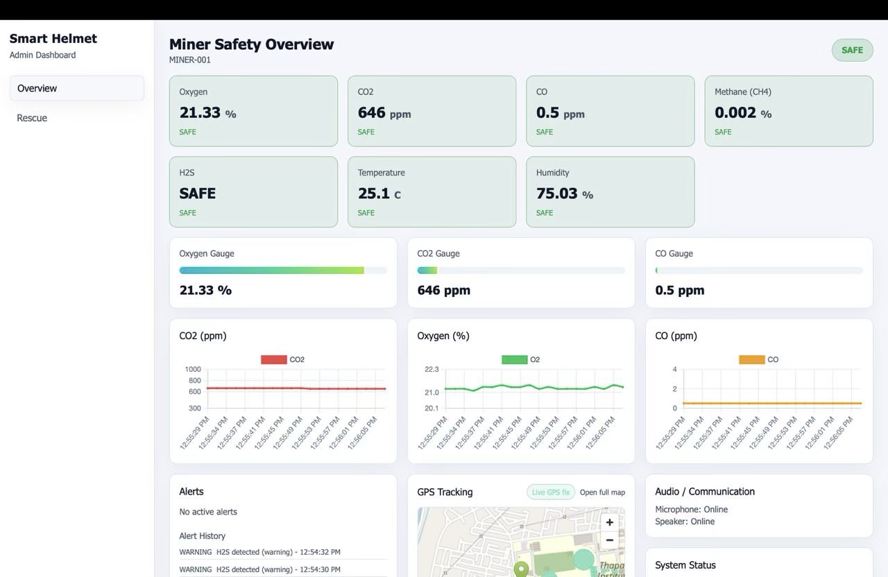
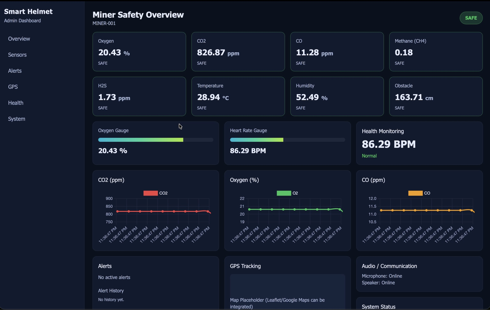

# Smart Mining Helmet



> An IoT safety monitoring system that combines ESP32 sensor telemetry, a Node.js API, SQLite persistence, and a responsive React dashboard for mining operations.

## 📋 Table of Contents

- [Project Overview](#project-overview)
- [Features](#features)
- [Dashboard Screens](#dashboard-screens)
- [System Architecture](#system-architecture)
- [Hardware Components](#hardware-components)
- [Project Structure](#project-structure)
- [Installation](#installation)
- [Usage](#usage)
- [API Documentation](#api-documentation)
- [Database Schema](#database-schema)
- [Arduino Sketches](#arduino-sketches)
- [Contributing](#contributing)
- [License](#license)

---

## 🎯 Project Overview

**Smart Mining Helmet** is designed to help operators monitor a miner's environment and location from a browser. The current dashboard monitors:

- **Environmental hazards**: Oxygen, CO2, CO, methane (CH4), and H2S
- **Environmental conditions**: Temperature and humidity
- **Location**: GPS coordinates, GPS fix freshness, and Wi-Fi zone positioning
- **Operational state**: ESP32 connectivity, per-sensor status, microphone, and speaker status
- **Safety response**: Threshold-based alerts, alert history, and a dedicated rescue view

The system consists of three main components:
1. **Arduino-based Hardware** - Sensor data collection via ESP32 microcontroller
2. **Backend Server** - Express.js API with SQLite database for data persistence
3. **Web Dashboard** - React-based real-time monitoring interface with data visualization

---

## ⭐ Features

### Core Monitoring
✅ **Real-time Sensor Data Streaming** - The frontend polls the backend every 2 seconds and marks data stale after 10 seconds without a successful response
✅ **Multi-gas Detection** - Oxygen, CO2, CO, Methane (CH4), and Hydrogen Sulfide (H2S)
✅ **Environmental Monitoring** - Temperature and humidity readings with per-sensor online/offline state
✅ **GPS Location Tracking** - Coordinates, zone labels, live-fix state, and last-fix age
✅ **Responsive Interface** - Dashboard layout adapts between desktop and mobile screens

### Safety & Alerts
✅ **Intelligent Alert System** - Three-tier alerting (Normal, Warning, Danger)
✅ **Audio and System Status** - Displays microphone, speaker, ESP32, and backend stream state
✅ **Alert History** - Keeps up to 1000 backend alerts and displays recent history in the dashboard
✅ **Threshold-based Triggering** - Server-side warning and danger evaluation for gas readings
✅ **Offline Handling** - Clears unsafe-to-display live values when the ESP32 or data stream is offline

### Rescue Operations
✅ **Emergency Rescue View** - Dedicated rescue screen available from the sidebar
✅ **Quick Location Data** - Exact zone, latitude, longitude, and links to external maps
✅ **Rescue Time Estimate** - Estimates remaining rescue time from oxygen and harmful-gas severity
✅ **Rescue Risk Indicators** - Harmful-gas cards and normal, watch, urgent, or unknown map states

### Data Management
✅ **Historical Data Storage** - SQLite persistence for sensor readings, alerts, miners, and sessions
✅ **Trend Analysis** - Rolling frontend charts for oxygen, CO2, and CO
✅ **Analytics API** - Historical readings, trends, hourly averages, and alert history endpoints
✅ **Session Tracking** - New recording sessions are created after the configured telemetry gap

## Dashboard Screens

### Overview

The Overview screen provides the operator's live safety picture:

- Overall SAFE, WARNING, or DANGER state
- Sensor cards for oxygen, CO2, CO, methane, H2S, temperature, and humidity
- Rolling oxygen, CO2, and CO charts
- Active alerts and scrollable alert history
- GPS map with zone and live-fix information
- Audio/communication and system status panels


### Dashboard reference image

The repository also includes an earlier dashboard reference image showing the same monitoring concepts in an alternate visual treatment.



### Rescue

The Rescue screen is opened from the sidebar and provides:

- Exact miner location and zone
- Links to Google Maps and OpenStreetMap
- Estimated rescue time remaining, updated every second
- Oxygen, temperature, and humidity vitals
- CO, CO2, H2S, and CH4 risk cards
- Urgency state for the rescue map and a GPS fallback when coordinates are unavailable

---

## 🏗️ System Architecture

```
┌─────────────────────────────────────────────────────────────┐
│                    Smart Mining Helmet                       │
├──────────────────────┬──────────────────────────────────────┤
│                      │                                        │
│   Arduino/ESP32      │        Backend Infrastructure         │
│   ─────────────────  │        ───────────────────────        │
│                      │                                        │
│  • Oxygen Sensor  ──┬┼─→ Express.js Server (Port 4000)      │
│  • CO2 Sensor     ──┤│    • CORS Enabled                     │
│  • CO Sensor      ──┤│    • Real-time APIs                   │
│  • CH4 Sensor     ──┤│    • Polling REST API                 │
│  • H2S Sensor     ──┤│                                        │
│  • Temp/Humidity  ──┤│    ┌─────────────────┐               │
│  • GPS Module     ──┤│    │  SQLite DB      │               │
│  • Audio Status   ──┤│    │ (helmet.db)     │               │
│                      │    │                 │               │
│                      │    │ • miners        │               │
│                      │    │ • sensors       │               │
│                      │    │ • alerts        │               │
│                      │    │ • sessions      │               │
│                      │    │ • rescue_missions
│                      │    └─────────────────┘               │
│                      │                                        │
└──────────────────────┴────────────────┬─────────────────────┘
                                        │
                    ┌───────────────────┴─────────────────────┐
                    │                                           │
            ┌───────▼────────┐              ┌──────────────────▼──┐
            │  Frontend App  │              │  Browser Client     │
            │  (React/Vite)  │              │  (Port 5173)        │
            ├────────────────┤              │                     │
            │ • Dashboard    │◄─────────────│ Real-time Data      │
            │ • Charts       │ REST API     │ Visualization       │
            │ • Alerts Panel │ (Port 4000)  │                     │
            │ • Map View     │              │                     │
            │ • Rescue View  │              │                     │
            └────────────────┘              └─────────────────────┘
```

---

## 🔧 Hardware Components

### Microcontroller
- **ESP32** - Main processing unit with WiFi connectivity

### Gas Sensors
| Sensor | Parameter | Range | Model |
|--------|-----------|-------|-------|
| **O₂ Sensor** | Oxygen Level | 0-25% | DFRobot OxygenSensor |
| **CO₂ Sensor** | Carbon Dioxide | 0-5000 ppm | MH-Z19B |
| **CO Sensor** | Carbon Monoxide | 0-1000 ppm | Serial-based |
| **CH₄ Sensor** | Methane | 0-100% LEL | MQ-4 |
| **H₂S Sensor** | Hydrogen Sulfide | 0-100 ppm | MQ-136 |

### Environmental Sensors
- **Temperature Sensor** - Temperature monitoring
- **Humidity Sensor** - Humidity monitoring

### Location
- **GPS Module** - Geographic positioning

### Audio
- **Microphone and speaker status** - Communication hardware state reported by the helmet

---

## 📁 Project Structure

```
smart-mining-helmet/
├── Arduino-sketches/              # Hardware firmware
│   ├── buzzer_code/              # Audio alert control
│   ├── CO_sensor/                # Carbon monoxide sensor interface
│   ├── CO2_sensor/               # Carbon dioxide sensor interface
│   ├── O2_CO/                    # Combined oxygen/CO reading
│   └── oxygen_sensor/            # Oxygen level monitoring
│
├── Dashboard/                     # Web application
│   ├── setup.sh                  # Initial project setup script
│   └── smart-helmet-dashboard/
│       ├── package.json          # Root package configuration
│       │
│       ├── backend/              # Express.js API Server
│       │   ├── package.json
│       │   ├── server.js         # Main server file
│       │   ├── database-schema.md # DB structure documentation
│       │   ├── zones.json         # Wi-Fi BSSID to zone mappings
│       │   └── database/
│       │       ├── init.js       # Database initialization
│       │       └── queries.js    # Database query functions
│       │
│       └── frontend/             # React Dashboard Application
│           ├── package.json
│           ├── vite.config.js    # Vite build configuration
│           ├── tailwind.config.js # Tailwind CSS setup
│           ├── postcss.config.js # PostCSS configuration
│           ├── index.html        # Entry HTML
│           └── src/
│               ├── main.jsx      # React entry point
│               ├── App.jsx       # Main app component
│               ├── index.css     # Global styles
│               │
│               ├── pages/        # Page components
│               │   ├── Dashboard.jsx  # Main monitoring dashboard
│               │   └── Rescue.jsx     # Emergency rescue interface
│               │
│               ├── components/   # Reusable UI components
│               │   ├── AlertsPanel.jsx     # Active alerts display
│               │   ├── AudioStatus.jsx     # Audio alert indicator
│               │   ├── ChartsPanel.jsx     # Data visualization
│               │   ├── GaugeCard.jsx       # Circular gauge displays
│               │   ├── HealthPanel.jsx     # Miner health info
│               │   ├── MapView.jsx         # GPS location map
│               │   ├── SensorCard.jsx      # Individual sensor display
│               │   ├── Sidebar.jsx         # Navigation sidebar
│               │   ├── SystemStatus.jsx    # Overall system health
│               │   └── Topbar.jsx          # Header information
│               │
│               ├── hooks/        # Custom React hooks
│               │   ├── useRealtimeData.js  # Polling and payload sanitization
│               │   └── useStableMapUrl.js  # Stable map embed URL
│               │
│               └── utils/        # Utility functions
│                   ├── status.js       # Status calculation logic
│                   └── thresholds.js   # Alert threshold definitions
│
└── README.md                    # This file
```

---

## 📦 Installation

### Prerequisites
- Node.js (v16 or higher)
- npm (v7 or higher)
- Arduino IDE (for uploading sketches to ESP32)

### Backend Setup

```bash
cd Dashboard/smart-helmet-dashboard/backend
npm install
```

**Dependencies:**
- `express` - Web server framework
- `cors` - Cross-Origin Resource Sharing
- `sql.js` - SQLite for JavaScript

### Frontend Setup

```bash
cd Dashboard/smart-helmet-dashboard/frontend
npm install
```

**Dependencies:**
- `react` - UI library
- `vite` - Build tool
- `tailwindcss` - Utility CSS framework
- `chart.js` & `react-chartjs-2` - Data visualization
- Embedded OpenStreetMap - Map display and external map links

### One-Command Installation

From the root `smart-helmet-dashboard` directory:

```bash
npm run install:all
```

### Arduino/ESP32 Setup

1. Install Arduino IDE from [arduino.cc](https://www.arduino.cc)
2. Add ESP32 board support via Board Manager
3. Upload sketches to ESP32:
   - Navigate to each sketch in `Arduino-sketches/`
   - Select appropriate board and COM port
   - Click Upload

---

## 🚀 Usage

### Start Development Environment

**Backend & Frontend (Concurrent):**
```bash
npm run dev
```

**Backend Only:**
```bash
npm run dev:backend
```
- Server runs on: `http://localhost:4000`

**Frontend Only:**
```bash
npm run dev:frontend
```
- Dashboard runs on: `http://localhost:5173`

### Accessing the Dashboard

1. Ensure backend server is running
2. Open browser to `http://localhost:5173`
3. Dashboard displays:
   - Live gas, temperature, and humidity readings
   - SAFE, WARNING, or DANGER sensor states
   - GPS location, zone, and fix freshness
   - Active alerts and alert history
   - Rolling oxygen, CO2, and CO charts
   - Audio and system connectivity status

### Rescue View

1. Click **"Rescue"** button in sidebar
2. System displays:
   - Miner's exact zone and last known coordinates
   - Current harmful-gas and vital readings
   - Estimated rescue time remaining
   - A map with urgency state and external map links

---

## 📡 API Documentation

### Base URL
```
http://localhost:4000
```

### Endpoints

#### Sensor Data
- **GET** `/api/data` - Return the latest telemetry, sensor status, GPS metadata, alerts, and alert history
- **POST** `/api/data` - Receive a telemetry payload from the ESP32

#### Health and Zones
- **GET** `/health` - Return backend health status
- **GET** `/api/zones` - Return configured and unmapped Wi-Fi zones
- **POST** `/api/zones/reload` - Reload `backend/zones.json`

#### Analytics
- **GET** `/api/analytics/sensors?minerId=MINER-001&hoursBack=24` - Historical sensor readings
- **GET** `/api/analytics/trends?sensor=oxygen&hoursBack=24` - Sensor trend data
- **GET** `/api/analytics/hourly-averages?sensor=oxygen&hoursBack=24` - Hourly averages
- **GET** `/api/alerts/history?minerId=MINER-001&hoursBack=24` - Stored alert history

#### Miners and Rescue
- **GET** `/api/miners` - List all registered miners
- **GET** `/api/miners/:minerId/latest` - Get latest stored miner data
- **POST** `/api/miners/:minerId/profile` - Update a miner profile
- **POST** `/api/rescue/mission` - Create a rescue mission record

---

## 💾 Database Schema

**Database:** SQLite (helmet.db)

### Main Tables

#### `miners`
Stores miner profiles and health information
```
miner_id (TEXT, PRIMARY KEY)
name (TEXT)
contact_info (TEXT)
health_profile (TEXT)
created_at (TEXT)
updated_at (TEXT)
```

#### `sensors`
Real-time and historical sensor readings
```
id (INTEGER, PRIMARY KEY)
timestamp (TEXT)
miner_id (TEXT, FK)
oxygen (REAL)           # Percentage
co2 (REAL)              # ppm
co (REAL)               # ppm
ch4 (REAL)              # Percentage
h2s (REAL)              # 0 = clear, 1 = warning, 2 = danger
temperature (REAL)      # °C
humidity (REAL)         # Percentage
latitude (REAL)
longitude (REAL)
created_at (TEXT)
```

#### `alerts`
Safety alerts and warnings
```
alert_id (INTEGER, PRIMARY KEY)
timestamp (TEXT)
miner_id (TEXT, FK)
alert_level (TEXT)      # NORMAL, WARNING, DANGER
message (TEXT)
sensor_type (TEXT)
reading_value (REAL)
threshold_value (REAL)
created_at (TEXT)
```

#### `sessions`
Work session tracking
```
session_id (INTEGER, PRIMARY KEY)
miner_id (TEXT, FK)
start_time (TEXT)
end_time (TEXT)
location_city (TEXT)
created_at (TEXT)
```

#### `rescue_missions`
Emergency rescue operations
```
mission_id (INTEGER, PRIMARY KEY)
miner_id (TEXT, FK)
timestamp (TEXT)
latitude (REAL)
longitude (REAL)
gas_hazard_level (TEXT)
status (TEXT)           # ACTIVE, COMPLETED
created_at (TEXT)
```

---

## 📝 Arduino Sketches

### File Descriptions

| Sketch | Purpose |
|--------|---------|
| `buzzer_code.ino` | Controls audio alert buzzer for critical warnings |
| `oxygen_sensor.ino` | Interfaces with DFRobot oxygen sensor via I2C |
| `CO_sensor.ino` | Reads CO levels via serial communication |
| `CO2_sensor.ino` | Interfaces with CO2 sensor module |
| `O2_CO.ino` | Combined sketch for simultaneous O2/CO monitoring |

### Calibration Notes
- **Oxygen Sensor**: Calibrate in fresh air (20.9%) at system startup
- **Gas Sensors**: Require warm-up period of 5-10 seconds
- **All Sensors**: Send readings at configurable intervals (default: 3 seconds)

---

## 🔑 Key Alert Thresholds

| Parameter | Warning Level | Danger Level |
|-----------|---------------|--------------|
| **Oxygen** | < 20.0% | < 19.5% |
| **CO₂** | > 1600 ppm | > 3500 ppm |
| **CO** | > 2 ppm | > 35 ppm |
| **CH₄** | > 0.5% | > 1.0% |
| **H₂S** | State 1 | State 2 |

*Thresholds can be adjusted in `frontend/src/utils/thresholds.js`. H2S is represented as a discrete sensor state: 0 = clear, 1 = warning, and 2 = danger.*

---

## 🤝 Contributing

Contributions are welcome! Please follow these steps:

1. Fork the repository
2. Create a feature branch (`git checkout -b feature/AmazingFeature`)
3. Commit changes (`git commit -m 'Add AmazingFeature'`)
4. Push to branch (`git push origin feature/AmazingFeature`)
5. Open a Pull Request

### Development Guidelines
- Follow existing code style
- Add comments for complex logic
- Test changes in development environment
- Update documentation as needed

---

## 📄 License

This project is licensed under the MIT License - see LICENSE file for details.

---

## 📞 Support & Contact

For issues, questions, or suggestions:
- Create an issue in the repository
- Contact the development team

---

## 🙏 Acknowledgments

- DFRobot for oxygen sensor library and documentation
- Arduino and ESP32 communities
- React and Vite ecosystems
- Tailwind CSS for styling framework

---

**Last Updated:** October 22, 2026
**Version:** 1.0.0
